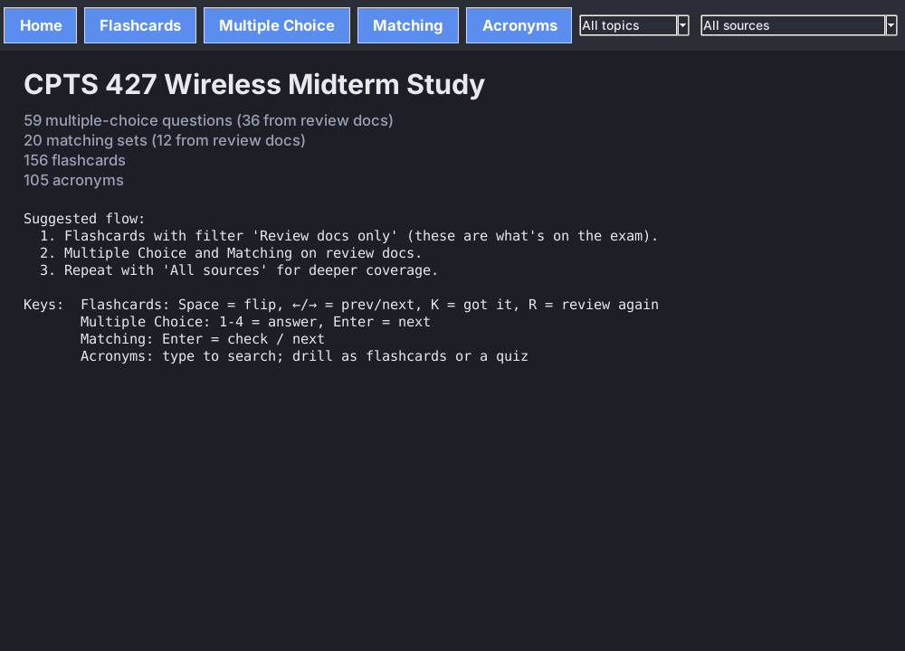
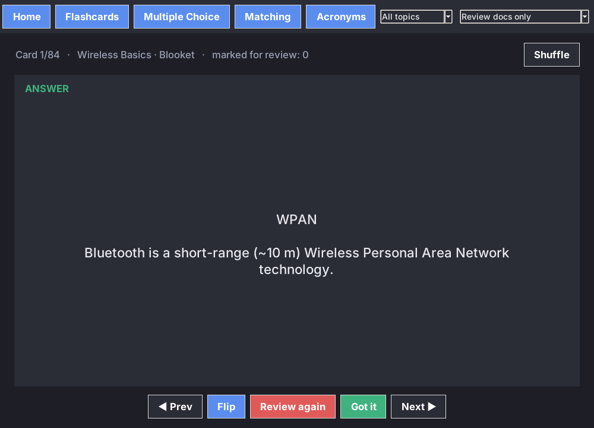
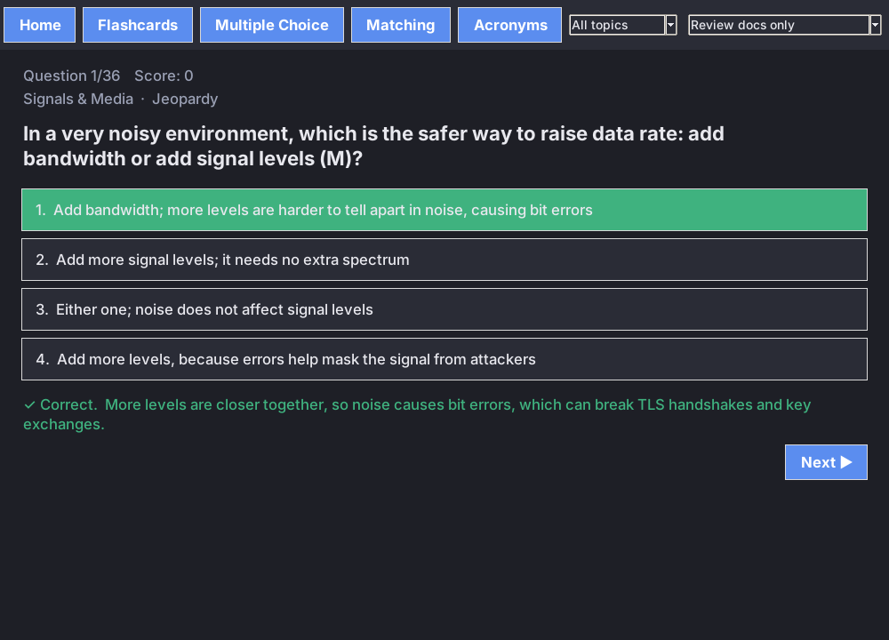
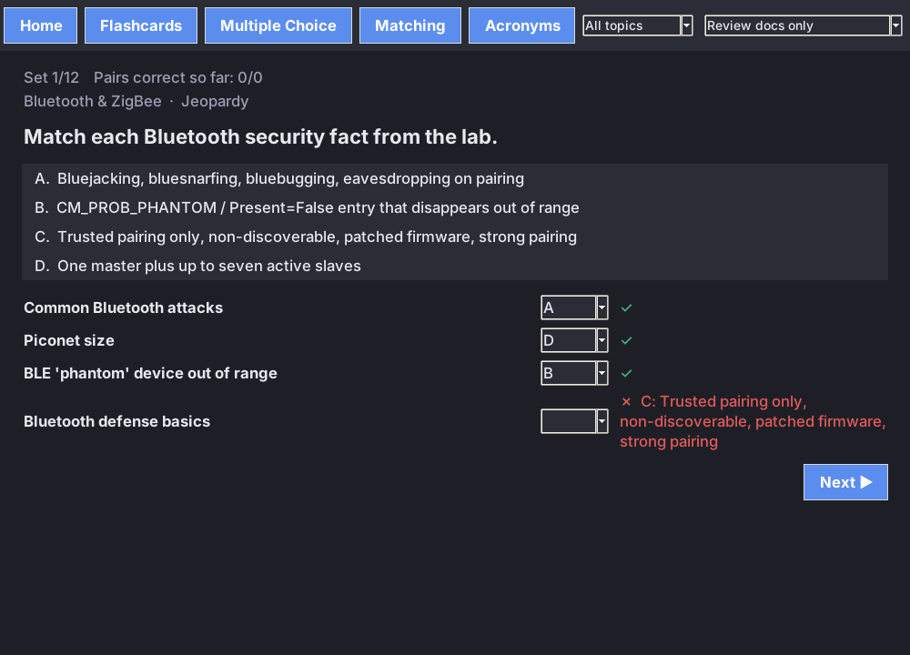
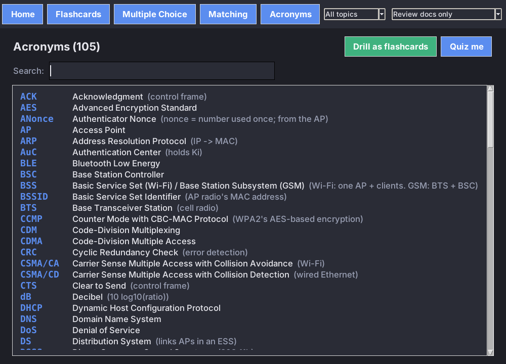

# CPTS 427 Wireless Midterm Study App

A free, open-source study tool for students preparing for the **CPT_S 427 Wireless Network Security** midterm at Washington State University Tri-Cities. It has flashcards, multiple-choice quizzes, matching drills, and an acronym reference, all built on one question bank you can edit.

I built this to study for my own midterm and published it so future students can use it too. Clone it, study with it, and adapt it for your semester. It's built with Python and Tkinter, so there's nothing to install beyond Python itself.

> **Note for future students:** The questions reflect the course as taught in **Fall 2026**. Topics, labs, and review materials may change between semesters, so use this alongside your current course materials, not as a replacement. Updates for newer semesters are welcome (see [Contributing](#contributing)).



## Features

| Mode | What it does |
|---|---|
| **Flashcards** | Click or press Space to flip. Mark cards *Got it* or *Review again*, then drill only the ones you missed. |
| **Multiple Choice** | Answer options are shuffled every round, and each answer shows an explanation. At the end you can retry just the questions you got wrong. |
| **Matching** | Match terms to definitions from a scrambled answer bank. Each pair is graded on its own. |
| **Acronyms** | 105 course acronyms with full names and short notes. Search them, drill them as flashcards, or take a "What does X stand for?" quiz. |

**Filters** (top right) work in every mode:
- **Source:** both review documents, or the lecture supplements only.
- **Topic:** Wireless Basics, Signals & Media, Networks & Switching, Wi-Fi / 802.11, Wireless Attacks, VPN & Defenses, Bluetooth & ZigBee, GSM / Cellular, or Distributed Systems & Blockchain.

### Question bank

| | From review documents | Lecture supplements | Total |
|---|---|---|---|
| Multiple choice | 36 | 23 | 59 |
| Matching sets | 12 | 8 | 20 |
| Key-term flashcards | – | 17 | 17 |
| Acronyms | – | – | 105 |

Flashcards are generated automatically from every question, matching pair, and key term (156 cards).

## Screenshots

| Flashcards | Multiple Choice |
|---|---|
|  |  |

| Matching | Acronyms |
|---|---|
|  |  |

## Getting started

**Requirements:** Python 3.8 or newer with Tkinter. Tkinter is included with the standard python.org installers for Windows and macOS.

```bash
git clone https://github.com/gastman98/cpts427-wireless-midterm-study.git
cd cpts427-wireless-midterm-study
python study_app.py
```

On macOS or Linux you may need `python3` instead of `python`.

If you get `ModuleNotFoundError: No module named 'tkinter'` on Linux, install it with:

```bash
sudo apt install python3-tk        # Debian / Ubuntu
sudo dnf install python3-tkinter   # Fedora
```

### Running from VS Code

1. **File → Open Folder** and select the project folder.
2. Open `study_app.py` and click **Run ▶**, or run `python study_app.py` in the integrated terminal.

## Keyboard shortcuts

| Mode | Keys |
|---|---|
| Flashcards | `Space` flip · `←` / `→` previous / next · `K` got it · `R` review again |
| Multiple Choice | `1`–`4` choose an answer · `Enter` next question |
| Matching | `Enter` check answers / next set |
| Acronyms | Type in the search box to filter |

## Suggested study flow

1. Set the filter to **Review docs only** and go through the Flashcards.
2. Take Multiple Choice and Matching on the review docs until you score near 100%.
3. Switch to **All sources** for broader coverage, and use the Acronyms quiz to lock in terminology.

## Project structure

```
cpts427-wireless-midterm-study/
├── study_app.py      # Tkinter application (all four modes)
├── questions.json    # Question bank: mc, matching, terms, acronyms
├── screenshots/      # Images used in this README
├── LICENSE
└── README.md
```

## Adding or editing questions

All content lives in `questions.json`. The app reads it at startup, so you don't need to change any code.

**Multiple choice** (`answer` is the 0-based index of the correct option):
```json
{"source": "Lecture", "topic": "Wi-Fi / 802.11",
 "q": "Which mechanism addresses the hidden-terminal problem?",
 "options": ["Beacons", "RTS/CTS", "Probe requests", "WEP"],
 "answer": 1,
 "explain": "The AP's CTS is heard by all stations, including the hidden one."}
```

**Matching:**
```json
{"source": "Lecture", "topic": "GSM / Cellular",
 "prompt": "Match each GSM security algorithm to its function.",
 "pairs": [["A3", "Authentication"], ["A8", "Generates Kc"], ["A5", "Air-interface encryption"]]}
```

**Key term:** `{"source": "Lecture", "topic": "...", "front": "Term", "back": "Definition"}`

**Acronym:** `{"a": "SSID", "full": "Service Set Identifier", "topic": "Wi-Fi / 802.11", "note": "network name"}`

The `source` field drives the filter. `"Blooket"` and `"Jeopardy"` count as review documents, and anything else counts as a lecture supplement. A new `topic` value shows up in the topic filter automatically.

## Content sources

- **Review documents:** the instructor-provided Blooket midterm review and the *Wireless Security* Jeopardy review. Blooket answers were checked against the official answer key.
- **Lecture supplements:** questions I wrote from the course lecture slides and assigned readings (the GSM security paper and the Bitcoin whitepaper).

This is an unofficial, student-made study aid. It isn't affiliated with or endorsed by Washington State University, and it doesn't replace the course materials.

## Contributing

This project is meant to keep helping students after I graduate, and contributions from current and future students are welcome.

- **Found a wrong answer or typo?** [Open an issue](https://github.com/gastman98/cpts427-wireless-midterm-study/issues) with the question text and the correction, and cite the lecture or slide if you can.
- **Taking the course in a later semester?** Add new questions to `questions.json` (see [Adding or editing questions](#adding-or-editing-questions)) and open a pull request. If the course content has changed significantly, consider giving new questions a distinct `source` such as `"Spring 2027 Review"`.
- **Want to make your own version?** Fork the repo and replace `questions.json` with your own question bank. The app works for any course.

To submit a pull request:
1. Fork this repo and create a branch: `git checkout -b add-questions`.
2. Edit `questions.json` and run `python study_app.py` to make sure it loads.
3. Commit, push, and open a pull request describing what you added.

Please only contribute questions you're permitted to share, and follow WSU's academic integrity policy. Don't submit actual exam questions.

## Built with

- Python 3 and Tkinter / ttk (standard library only)
- Developed with AI assistance (Claude)

## License

Released under the [MIT License](LICENSE). You're free to use, copy, modify, and share this project, including for your own courses.

## Author

**Garrett Gastman**, Computer Science, Washington State University Tri-Cities
GitHub: [@gastman98](https://github.com/gastman98)
